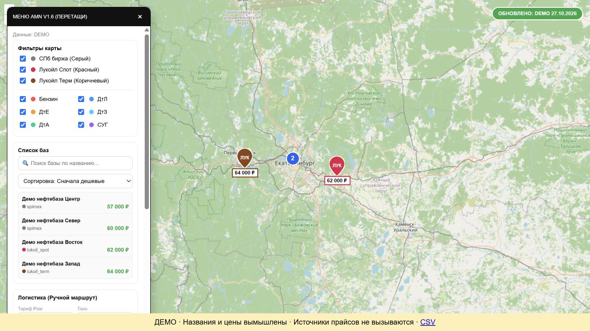

# Карта цен топлива и расчёта доставки

Интерактивная карта нефтебаз на OpenLayers. Python обрабатывает прайсы, а браузер показывает предложения, фильтры и маршруты доставки.

## Возможности

- Разбор PDF-прайсов и файлов Excel.
- Поиск нефтебаз и фильтры по компании и виду топлива.
- Отображение цен на маркерах карты.
- Построение маршрута через OSRM и расчёт логистической стоимости.
- Экспорт обработанных цен в CSV.
- Выбор картографического слоя через переменные окружения.

**Стек:** Python, pandas, pdfplumber, Jinja, OpenLayers, OSRM, Docker Compose, nginx.

## Структура и запуск

Исходники находятся в [`AMN/oil-prices-map-main`](AMN/oil-prices-map-main/). Вложенный [README](AMN/oil-prices-map-main/README.md) описывает параметры карты.

```sh
cd AMN/oil-prices-map-main
docker compose up --build
```

Compose запускает генератор и nginx на локальном порту 80. Если порт занят, измените проброс порта сервиса `web`. Прайсы из `data/` обрабатываются в `output/`; исходники парсеров и клиентской карты находятся в `src/`.

## Как посмотреть реализацию

Начните с `main.py`, `src/parsers.py`, `src/js/map.js` и `src/config.py`. Сохранённый `output/index.html` показывает результат генерации. Сохранённая страница и demo-prices.csv созданы из вымышленных данных. Исторические коммерческие прайсы исключены из этой версии; рабочий запуск требует собственных входных PDF/XLSX.

Карты и маршруты требуют сетевого доступа. Работоспособность источников на текущую дату не подтверждена; репозиторий не содержит штатного набора автотестов. Лицензия проекта пока не задана.

## Демо без загрузки прайсов

```sh
cd AMN/oil-prices-map-main
python -m pip install -r requirements.txt
python demo/generate.py
python -m http.server 8763 --bind 127.0.0.1 --directory output
```

Откройте http://127.0.0.1:8763. Используются рабочие Jinja-шаблон, OpenLayers-клиент и CSV exporter с вымышленными входами. Для тайлов и маршрутов нужна сеть. Сохранённый output/index.html теперь относится к этой демонстрации, не к историческим коммерческим прайсам.

## Проверка и реальный экран

[Результаты и ограничения проверки](docs/verification.md). Скриншот получен при локальном запуске на вымышленных данных.


